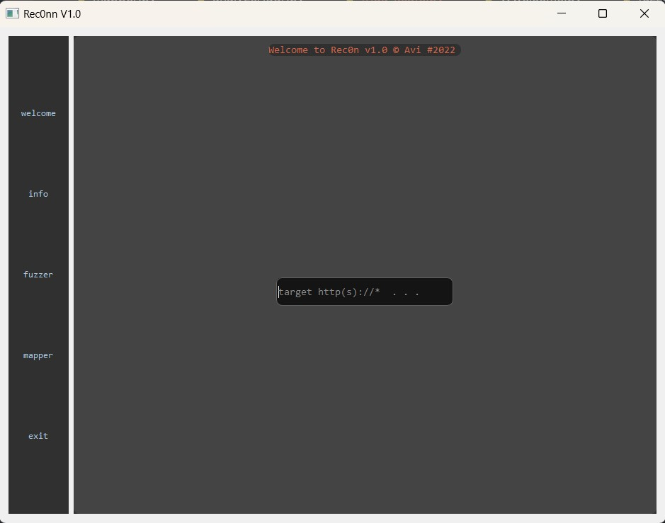
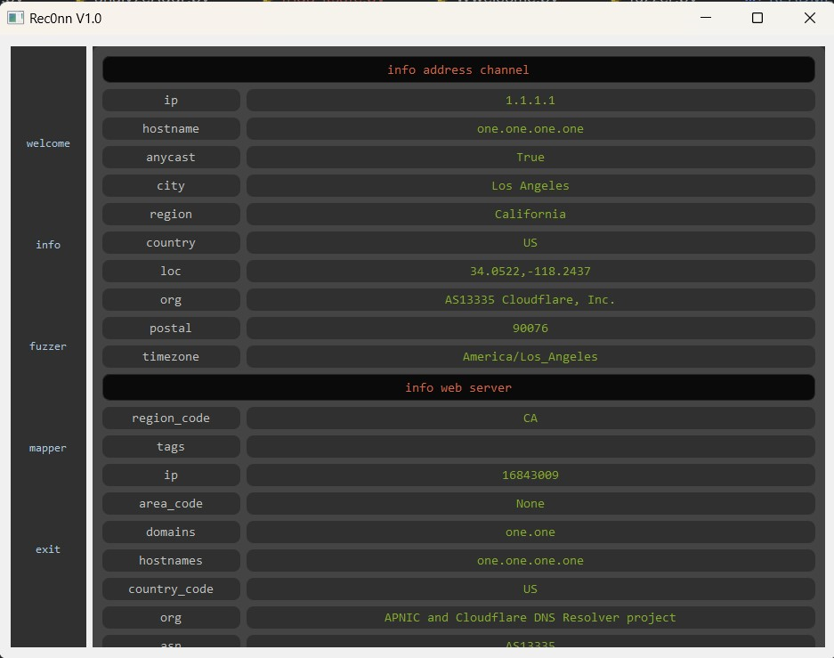
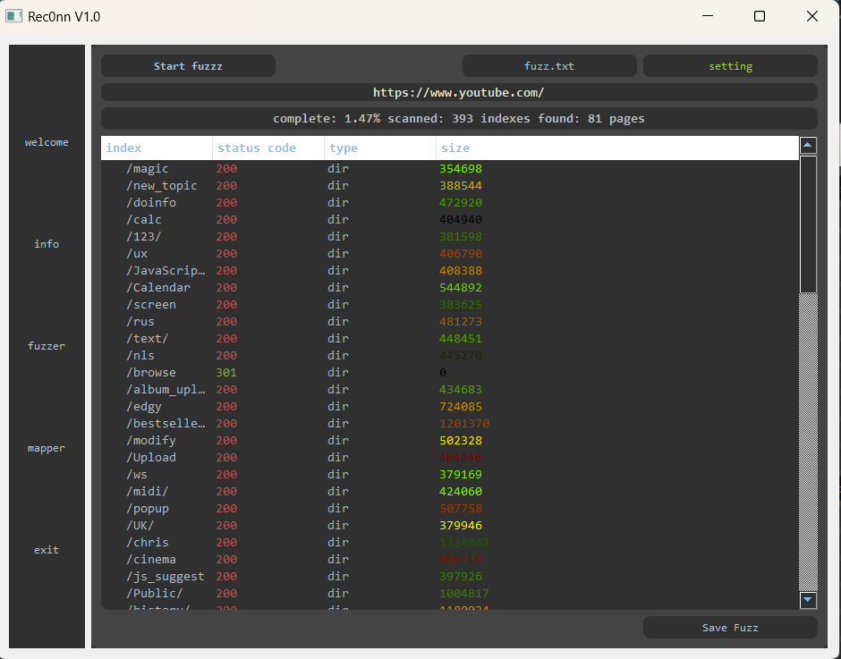
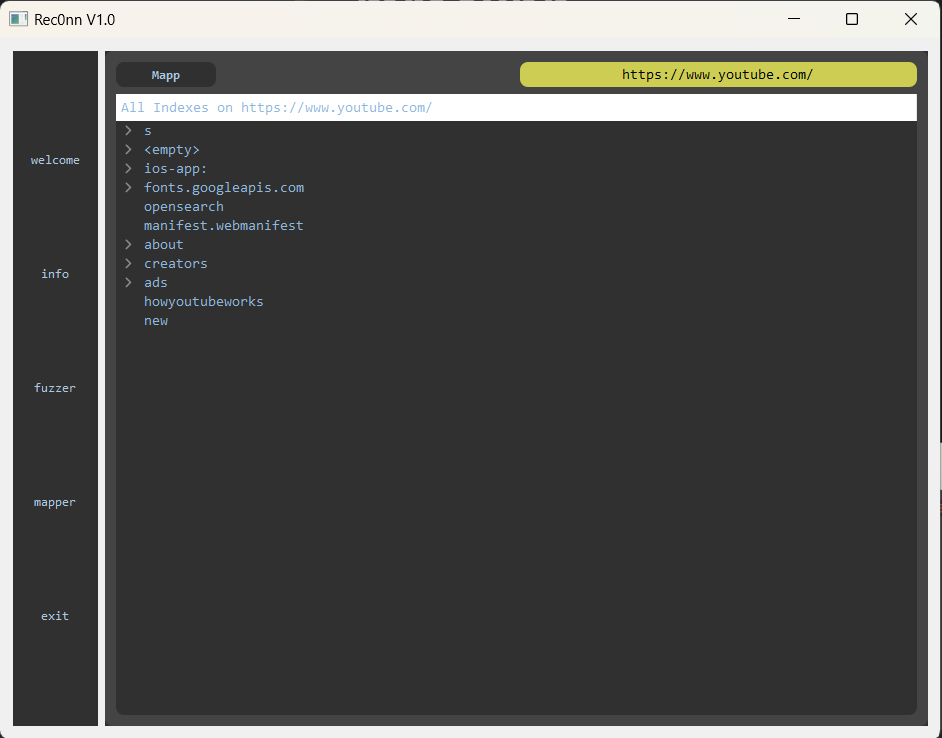

# mrec0nn

**mrec0nn** is a Python desktop application for web reconnaissance and authorized web security testing. The interface groups functionality into information lookup, directory/index fuzzing, and link/path mapping.

> **Authorized use only:** Run this tool only against systems you own or have explicit permission to test. Fuzzing and reconnaissance can generate traffic, trigger security controls, or affect target availability. Respect the target's rules of engagement and rate limits.

## Features

- **Welcome / target setup:** configure the target address before using the tools.
- **Information lookup:** query IP information providers for a valid IPv4 address.
- **Fuzzer:** test candidate paths from a wordlist and display HTTP response information.
- **Mapper:** collect and organize links and paths discovered in a page.
- **Custom wordlists:** load a text file containing candidate paths.
- **Desktop UI:** PyQt5 interface for interacting with the modules.

The behavior and availability of third-party information services depend on their APIs, credentials, quotas, and terms of service.

## Screenshots

### Welcome


### Information lookup


### Fuzzer


### Mapper


## Requirements

- Python 3.10 or newer (the source uses modern type annotations).
- pip.
- A graphical desktop session supported by PyQt5.
- Network access for features that query remote services or test a target.

## Installation

Clone the repository and enter its directory:

```bash
git clone https://github.com/saban248/mrec0nn.git
cd mrec0nn
```

Create and activate a virtual environment.

**Windows (PowerShell):**

```powershell
py -m venv .venv
.\.venv\Scripts\Activate.ps1
python -m pip install --upgrade pip
pip install -r requirements.txt
```

**Linux / macOS:**

```bash
python3 -m venv .venv
source .venv/bin/activate
python -m pip install --upgrade pip
pip install -r requirements.txt
```

If installation fails, confirm that your Python version is supported by the installed PyQt5 wheel and that your operating system has the libraries required by Qt.

## Run

From the repository root, run:

```bash
python rec0nn.py
```

The application opens a desktop window. Set a target before opening the information, fuzzer, or mapper views. Start with a local test application or a target explicitly authorized for testing.

## Wordlists

The fuzzer accepts a text file containing candidate paths, typically one entry per line. Use a small, purpose-built wordlist when testing. The current implementation applies a file-size limit and checks average line length; some wordlists may be rejected by these checks.

## Tests

Install the development dependencies:

```bash
pip install -r requirements-dev.txt
```

Run the unit tests from the repository root:

```bash
python -m pytest -q
```

The unit tests cover pure utility behavior and do not intentionally send requests to external services or scan a target. They are a starting point, not a complete security or integration test suite.

## Configuration and API credentials

The information lookup module calls third-party IP information services. Review `Api/analyzeAddr.py` and the relevant providers' current documentation for credential, quota, and terms-of-use requirements. Do not add personal or organization-specific secrets to a public repository. Prefer environment variables or a local configuration file excluded from version control for credentials. If a credential has been published and should no longer be public, rotate it with the provider; deleting it from the latest file alone does not remove it from Git history.

## Known limitations

- The application is an older project and has not been fully modernized or security-audited.
- API behavior depends on external providers and their availability.
- The current code includes platform-specific behavior in some utilities; in particular, opening URLs uses Windows command handling.
- Automated tests currently focus on deterministic utility functions. Network workflows, GUI behavior, and live target interactions are not covered by the initial test suite.
- Only test systems for which you have explicit authorization.

## Project structure

```text
mrec0nn/
├── Api/              # Address helpers, fuzzing, mapping, HTTP status checks
├── AppUI/            # PyQt5 user interface
├── tests/            # Automated unit tests
├── rec0nn.py         # Application entry point
├── requirements.txt  # Runtime dependencies
└── README.md
```

## License

No license file was present in the supplied project archive. Add a `LICENSE` file before presenting the repository as open source, and choose a license that matches your intentions and any third-party code or assets included.
